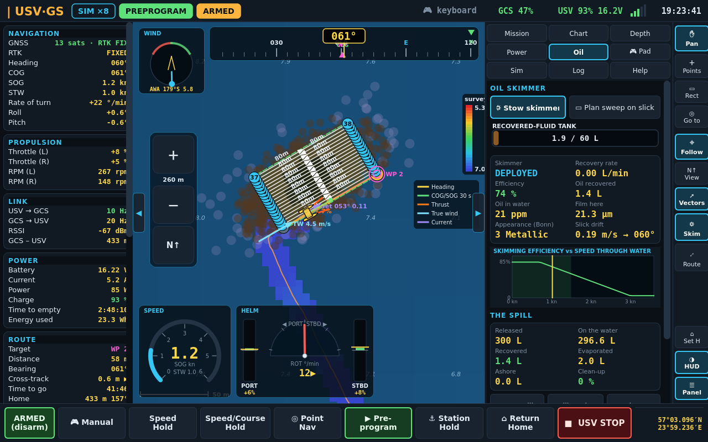
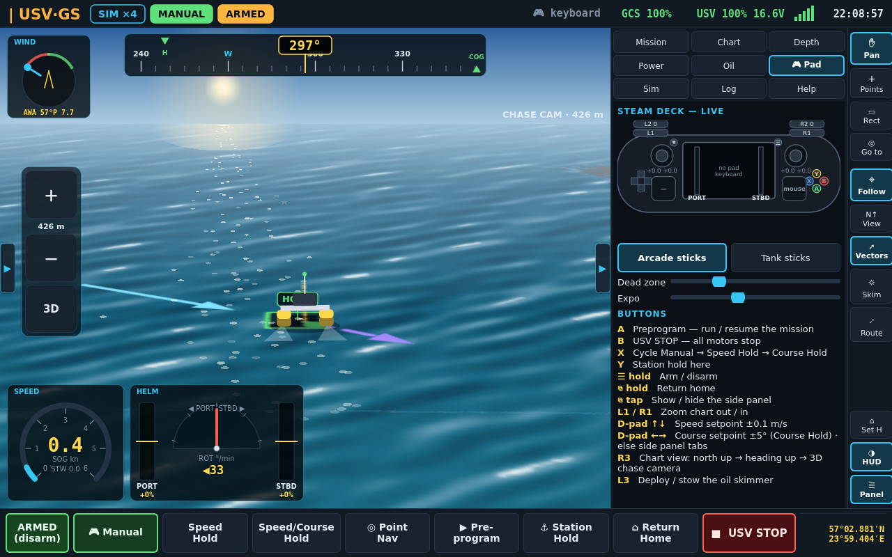
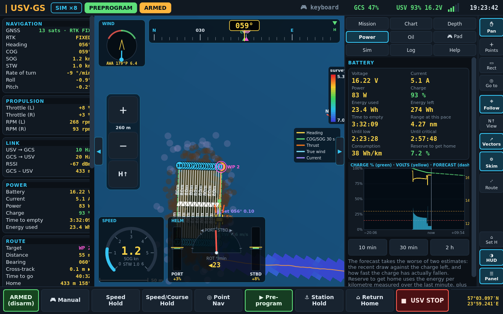

# USV·GS — a portable ground station for a catamaran USV

A ground control station for a small twin-hull, twin-motor survey boat, made to
run on a **Steam Deck**. You drive the boat directly with the Deck's sticks, or
plan a route on an offline depth chart and let the autopilot run it. Routes are
waypoints, or a rectangle swept in survey lanes. Everything works with no
internet.

For now it is a **game**: the boat is a simulated catamaran on the real Gulf of
Riga, with wind, current, a draining battery, an echo sounder and a
water-quality sonde. It also carries an **oil skimmer**, and there is a slick
on the water to clean up (see [docs/SKIMMER.md](docs/SKIMMER.md) for the
concept). The rest of the program only talks to the boat through a
link interface, so a real boat can replace the simulator later without the
station changing.



The layout follows USV stations used in the field:

- **Left:** telemetry.
- **Middle:** the chart, with the instruments over it.
- **Right:** a tool strip and a nine-page side panel.
- **Bottom:** the control modes, where the thumbs reach them.

Both side panels open and close with the ◀ ▶ tabs on the chart's edges
(**T** and **Tab** on a keyboard; **⧉** on the Deck toggles the right one).
They stay as you left them between runs.

| | |
|---|---|
|  |  |
| **3D chase camera** over natural water, with the Pad page showing the Deck's live controls | **Heading up**, with the Power page: battery graph and forecast |

---

## Run it

The station is written in Rust (egui for the window, gilrs and raw evdev for
the gamepad). It needs a Rust toolchain to build: <https://rustup.rs>.

```bash
./run.sh              # full screen on a 1280×800 display, a window elsewhere
./run.sh --windowed
./run.sh --view chase # start in the 3D chase camera (north, heading or chase)
./run.sh pads         # check the gamepad / Deck controls are seen
./run.sh --view power # start on the power-flow diagram
./run.sh --mission my-survey.json
./run.sh say shallow --lang ru   # hear an alert: shallow, aground, link-lost, …
./run.sh sounds       # fetch the voice packs again
```

Building needs the ALSA headers for sound (`alsa-lib` on Arch/SteamOS,
`libasound2-dev` on Debian/Ubuntu).

The first run compiles the release build, which takes a few minutes. After
that the station starts straight away. The depth chart is built into the
program, so the single binary `target/release/usvgs` is all it needs (plus
`maps/` for the street map).

Settings live in `~/.config/usvgs/config.json`; files written by the earlier
Python station still load.

### On the Steam Deck

In Desktop Mode, open Konsole in this folder and run:

```bash
./install.sh
```

The Deck has no Rust compiler, and it doesn't need one: the repository carries
a prebuilt `bin/usvgs`, which `run.sh` uses when Rust is not installed. It is
built in a Debian 12 distrobox (glibc 2.35), so it runs on SteamOS. To rebuild
it from the current sources, on the Deck or on any Linux PC with distrobox:

```bash
./install.sh --build      # or just: ./steamdeck/build.sh
```

This creates a `usvgs-build` container with its own Rust toolchain (kept in
`~/.local/share/usvgs-rust`), and nothing is installed on SteamOS itself.

That adds **USV Ground Station** to the menu. Then, in Steam, use *Add a
Non-Steam Game* and pick it, and choose the *Gamepad with Mouse Trackpad*
controller layout. It now starts from Game Mode:

- the sticks and buttons drive the boat;
- the right trackpad is a mouse for the chart;
- the touchscreen works too.

---

## Driving

Arm first: **hold ☰** (Enter on a keyboard). Until then the motors get zero,
whatever you press.

| Control | Does |
|---|---|
| Left stick ↕, or **R2** ahead / **L2** astern | Throttle (arcade sticks) |
| Right stick ↔ (or left stick ↔) | Steer, by differential thrust; it pivots at zero throttle |
| **A** | Preprogram — run or resume the mission |
| **B** | **USV STOP**: all motors to zero |
| **X** | Cycle Manual → Speed Hold → Speed/Course Hold |
| **Y** | Station hold where the boat is |
| hold **⧉** | Return home |
| tap **⧉** | Show or hide the side panel |
| **L1 / R1** | Zoom the chart |
| D-pad ↑↓ | Speed setpoint ±0.1 m/s |
| D-pad ←→ | Course setpoint ±5° in Course Hold; otherwise switch panel tabs |
| **R3** | Chart view: north up → heading up → 3D chase camera |
| **L3** | Deploy / stow the oil skimmer |

On a keyboard: WASD or the arrows drive, Shift boosts, Space is USV STOP, keys
1–7 pick the modes, + and − zoom, F follows the boat, V changes the view, G
toggles the vectors, N cycles natural water / depth chart / satellite, K the
skimmer, P the power-flow diagram, Tab and T the side panels, and F11 full screen.

The **Pad** page draws the Steam Deck with its sticks, triggers and buttons
moving live, and shows the two motor levels they add up to. It is also where
you choose *arcade* or *tank* sticks (tank: left stick = port motor, right =
starboard) and set the dead zone and expo.

**Pushing a stick hard in any automatic mode takes manual control back.** This
is the same rule real autopilots use.

### Modes

| Mode | What the boat does |
|---|---|
| **Manual** | Sticks straight to the motors |
| **Speed Hold** | Autopilot holds the speed; you steer |
| **Speed/Course Hold** | Holds speed and course; the sticks or D-pad nudge them |
| **Point Nav** | Goes to a point you tap on the chart, then keeps station there |
| **Preprogram** | Runs the mission |
| **Station Hold** | Keeps station on the spot, correcting when it drifts out of 3 m |
| **Return Home** | Back to the launch point, then station hold |
| **USV STOP** | Motors at zero; the boat drifts |

The autopilot is the usual set of parts:

- line-of-sight guidance along each leg;
- a heading PID that damps on the gyro's rate of turn;
- speed control on speed over ground;
- a learned crab angle, so a cross-current does not push the boat off its line.

---

## The chart views and vectors

- **N↑ north up:** a chart.
- **H↑ heading up:** the chart turns so the bow points up, with more water
  ahead than astern. A red arrow shows north.
- **3D chase camera:** a third-person view behind the boat, like a driving
  game. The heading-up chart is laid out in perspective under a sky, the
  catamaran is seen from astern heeling with the swell, and upright tags mark
  the target and home. Taps still work: *Go to* sends the boat where you
  touch the water.

Change view with the big **N↑/H↑/3D** button by the zoom buttons, the tool
strip, **R3** or **V**. The chase camera zooms out to about 5 km; the flat
views go to 35 km.

**The water** has three looks, switched on the *Chart* page or with **N**:

- **Natural water** (the default): the colour of water over the bottom at
  that depth, from sand-turquoise in the shallows to dark blue offshore, with
  waves that run downwind and grow with the wind (in light air they run with
  the current instead, and the whole pattern drifts with the flow), and surf along the beach
  when you are close in. In the chase view the far water mirrors the sky, and
  when the camera faces the sun (placed by the clock) its glitter lies on
  the water. Shallows under the depth alarm keep a warm tint, and the
  isobaths and spot depths still show.
- **Depth chart colours:** the depth shading of a nautical chart.
- **🛰 Satellite:** aerial imagery (Esri World Imagery by default; set
  `map.satellite_url` for another `{z}/{x}/{y}` source and respect its terms).
  Tiles are cached in `~/.cache/usvgs/tiles/`, so imagery once seen works with
  no internet. Before a trip, frame the area and press *Save view offline* on
  the *Chart* page: it stores the view at the zooms around the current one.
  While a tile is missing, a coarser one is stretched over its place.

**Frame rate:** the chart draws at 60 fps (or 30 to save battery: *Chart*
page, *Display*; *Show FPS* puts a counter in the corner). Position reports
arrive ten times a second, so between them the boat is carried on by its
speed, course and rate of turn, and each new fix is blended in rather than
jumped to. The panels around the chart refresh at 20 Hz on the same clock.

**Zooming with fingers:**

- pinch with two fingers, which also pans if you move them together;
- or press and hold the big **＋ / －** buttons on the chart's left edge;
  between them is how much water is on screen.

**Vectors at the boat** (toggle with *Vectors* or **G**; a legend is on the
chart):

| Colour | Vector |
|---|---|
| orange | **thrust**, along the bow, with an arc for the turning moment of the two motors |
| cyan | **true wind**, worked out from the apparent wind and the boat's own motion |
| violet, dashed | **current**: set and drift, the difference between motion over the ground and through the water |
| green | course and speed over ground: where the boat will be in 30 s |
| yellow, dashed | heading |

## Planning

Use the tools on the right-hand strip or the **Mission** tab.

- **Points** — tap the water to add waypoints. Drag one to move it; right-click,
  or select it and press *Delete point*, to remove it. Leg lengths are drawn on
  the chart.
- **Rect** — drag out a rectangle on the water: drag a corner to resize it,
  the middle to move it, the yellow handle to rotate it. The route follows as
  you change it, in the pattern picked on the *Mission* page:

  | Pattern | Route |
  |---|---|
  | **Lawnmower** | parallel lanes back and forth: the standard echo-sounder survey |
  | **Grid** | lanes one way, then across them: every spot crossed twice |
  | **Spiral in** | a rectangular spiral from the edge in to the centre |
  | **Spiral out** | from the centre out to the edge |
  | **Perimeter** | round the edge, any number of laps |
  | **AI · beta** | *in development:* tries the lane and spiral patterns from every corner, scores each on time to run it (including the transit from the boat and the turns) and on charted water shallower than the alarm, and picks the best. It says what it chose and why. It is a search, not a learned model |

  Settings: **swath** (what one pass covers) and **overlap %**, which give
  the lane spacing; **edge offset** (kept inside the rectangle); rotation;
  lanes along the long or short side; and the **start corner**, named by
  compass point.
- **Go to** — tap a point and the boat drives there (Point Nav).

Speeds show in **knots or m/s** (the button beside *Cruise speed*, or the
*Chart* page); the choice applies everywhere. Select a waypoint in the list to
give it its own speed or a hold.

Missions save and open as JSON (the rectangle and pattern with them, so a
survey can be reopened with a different spacing), and export as a
`.waypoints` file (QGC WPL 110) for ArduPilot / Mission Planner /
QGroundControl, with speed changes and holds.

---

## Side panel pages

| Page | What is on it |
|---|---|
| **Mission** | Planning tools, rectangle pattern settings, waypoint list, open/save, start |
| **Chart** | Layers, depth alarms, survey export, load another depth chart |
| **Depth** | Depth under the keel and on the chart. *Route ahead*: the water down to the seabed along the remaining route, with draft and alarm lines and the least water on it. Surveyed stretches are marked green. Also a full-size five-minute echo-sounder graph |
| **Power** | Voltage, current, power, charge, energy used and left. Time to empty, to low and to critical, range at this pace, Wh/km, and the charge needed to get home. A graph of charge, voltage and current, with a dashed **forecast** to empty and markers where it crosses the thresholds |
| **📡 Link** | Every data path (Wi-Fi, 5G/LTE, LoRa, telemetry radio …): state, data in and out, packet loss, latency, signal and SNR, how full it is, packet counts; graphs of rate and loss over two minutes; *Use* to take a path out |
| **ℹ Info** | The connection (kind, how long, report rates, distance), the boat (autopilot, firmware, mode, system id, uptime) and the station (version, controller, battery, folders) |
| **⚙ Limits** | Maximum speed, acceleration, deceleration and rate of turn; whether they also bind the sticks; live gauges of speed and turn against them |
| **🔊 Sound** | Voice alerts on/off, English or Russian, volume, and the rules: per alert on/off, repeat interval and warning tone, with a ▶ to hear each |
| **Oil** | Skimmer deploy/stow, tank gauge, recovery rate, efficiency, oil in water and film thickness with its Bonn code. An efficiency-against-speed curve with the boat's speed on it, the spill totals and *Plan sweep on slick* |
| **🎮 Pad** | The live Steam Deck diagram, stick layout, dead zone and expo |
| **Sim** | Weather, time scale, radio range, respawn/launch/recharge/pause |
| **Log**, **Help** | Messages, and the controls |

## Power flow

**⚡ Power** on the tool strip (or **P**) swaps the chart for a diagram of the
power system: shore power, the port and starboard battery banks (charge,
voltage, current, cell balancing and temperatures), their connectors, the
power bus down the boat, the equipment load and both thrusters with their
power and RPM. Dots run along each line the way the power flows, faster for
more. On the right: the runtime left at the current draw, and the charge over
time with its forecast.

In the simulator the pack is two banks in parallel that drift slightly apart
and balance, warm up under load, and charge from the ground station's supply
when the boat lies alongside with its motors still.

## Connecting: simulator or boat

At start the station asks **which boat**:

- **Simulator**: the simulated catamaran, as before.
- **Boat**: a real ArduPilot Rover (boat frame, skid steering) over MAVLink:
  - **UDP listen** (the boat or a Wi-Fi bridge sends to the Deck, usually port 14550)
  - **UDP to** an address
  - **TCP** (ArduPilot SITL: `127.0.0.1:5760`)
  - **Serial radio** (SiK/RFD on USB, 57600 baud; the devices are listed)

Tick *Connect like this at start, without asking* to skip the dialog next
time. Click the link name in the status bar (e.g. `SIM ▾`) to switch at any
time: the old boat is disarmed first, and the mission and survey carry over.
From the command line: `usvgs --sim` or `usvgs --connect udp-listen:14550`
(also `udp:HOST:PORT`, `tcp:HOST:PORT`, `serial:/dev/ttyUSB0:57600`).

With a real boat the autopilot runs on the station, as with the simulator.
The boat is put in MANUAL and driven by RC override (throttle on channel 3,
steering on channel 1, 1100–1500–1900 µs; see `link` in the settings file).
If the link drops, ArduPilot's own RC-override timeout and failsafe stop the
boat. The station reads position, heading, attitude, GPS fix, battery
(SYS_STATUS), motor outputs (SERVO_OUTPUT_RAW, servos 1 and 3 by default), a
downward rangefinder as the echo sounder, radio RSSI, and the boat's text
messages, which go to the Log. If the boat refuses to arm (failed pre-arm
checks), the Log says so.

## Data paths: LoRa, Wi-Fi, 5G …

A boat can be reached several ways at once, and the **📡 Link** page meters
each one: data rate each way, packet loss, latency, signal and SNR.

- **Simulator:** three paths. **Wi-Fi** (400 m, fast), **5G / LTE** (to
  4 km offshore) and **LoRa** (868 MHz, 8 km, 5.5 kbit/s). The best working
  one carries the telemetry and commands; the others send a keep-alive each
  second, so their loss is always known. Moving out of range hands over
  Wi-Fi → 5G → LoRa at once, and back only once the better path has held for
  3 s, so it doesn't flap. On LoRa the boat sends a compact report at 2 Hz.
  The ranges are on the **Sim** page; untick *Use* on the Link page to try a
  failure. The status bar shows the path in use (`SIM · 📶 Wi-Fi`).
- **Real boat:** add several paths in the start dialog (**+ Add a path**, then
  pick what carries it), or write them comma-separated:
  `usvgs --connect "lora=serial:/dev/ttyUSB0:57600, wifi=udp-listen:14550, cellular=udp:10.8.0.2:14550"`.
  Kinds: `wifi`, `cellular` (5g/lte), `lora`, `radio` (SiK/RFD), `satellite`, `ip`.
  Every path is read and metered. Loss comes from MAVLink sequence gaps,
  signal from the radio's RADIO_STATUS, latency from TIMESYNC round trips.
  The boat's messages are taken from the path in use, and from the others
  only while it is quiet, so nothing is counted twice. Heartbeats and arming
  go on every path. The driving (RC override) goes on the preferred working
  path (Wi-Fi, network, 5G, radio, LoRa; a path losing over a third drops
  down the list), one override in four on LoRa or satellite.

## Motion limits

On the **⚙ Limits** page (and in `limits` in the settings file):

| Limit | How it is enforced |
|---|---|
| **Max speed** | a governor on speed over ground: the throttle eases off as the boat nears the limit, so it settles at it. The autopilot's cruise, waypoint and hold speeds are capped at it too |
| **Acceleration / deceleration** | the throttle may only rise (or fall) so fast, worked out from m/s² and the boat's top speed |
| **Rate of turn** | the steering fades as the turn nears the limit, with a little counter-steer past it |

They apply in every mode, and to the sticks unless *Limit the sticks too* is
off. **USV STOP and disarming are never limited.** When a limit is holding the
boat back, the status bar says which; the speed dial has a red mark at the
speed limit.

## Voice alerts

The station speaks, as a cockpit does. Running into water shallower than the
alarm sounds a two-tone whoop and **"Danger, danger"** — in Russian
**"Слишком низко"**, the way a Russian ground-proximity warning calls "too
low" — and repeats every five seconds until the water is deep enough again;
aground adds "Stop". It also calls link lost and recovered, battery low and
critical, the geofence, GNSS lost and found, a full skimmer tank, arming and
the mode changes. Choose English or Russian and the volume on the **🔊 Sound**
page.

Each alert has a **rule**: on or off, how often it is said again while it
lasts (once, or every 5 s … 2 min), and whether the two-tone warning goes
first. When several warnings are due at once only the most urgent is said
(aground, shallow, link, battery critical, geofence, GNSS, battery low, tank),
and by default warnings repeat only while armed, so a boat tied up at the
station is told it is aground once rather than every five seconds.

The phrases are the [EdgeTX sound packs](https://github.com/EdgeTX/edgetx-sdcard-sounds)
(GPL-2.0), kept unchanged in `sounds/` with their licence, not compiled into
the program.

## The oil skimmer

The boat carries sweep arms and a brush skimmer between the hulls. The sim
puts a 300 L slick 450 m off the launch point. It drifts with the current plus
3 % of the wind, spreads, evaporates, and beaches if you leave it.

To clean it up:

1. *Plan sweep on slick*: lanes one swath apart over the slick, at boom speed.
   The pattern drifts with the oil.
2. Deploy the skimmer (**L3** or **K**).
3. Run the mission (**A**).

Keep under about 1.5 kn or the oil escapes under the arms. When the tank is
full, stow the skimmer and come alongside the GCS to pump out. The concept,
and how each part is modelled, is in [docs/SKIMMER.md](docs/SKIMMER.md).

---

## The chart, offline

There are two layers, kept apart because they deserve different trust:

- **The depth chart.** The bundled one is EMODnet Bathymetry's Gulf of Riga
  model (`data/riga_bathy.npz`, 150 KB, built into the program, about 115 m per cell). It is shaded
  by depth, with isobaths, and spot depths appear when you zoom in. Water
  shallower than the alarm depth is coloured as a hazard. EMODnet has no
  soundings for inland lakes, so their depth was *estimated* from the distance
  to the shore. Those cells are marked `~` and dimmed.
- **Your survey.** Every echo-sounder ping is binned into 5 m cells and drawn
  in the multibeam palette (red shallow, blue deep). The area under the boat's
  track fills in with the real seabed, including detail the coarse chart does
  not show. *Area covered* tells you how much of the rectangle has been sounded.
  Export the raw soundings (`lon,lat,depth_m,time`) or the binned grid as CSV
  from the **Chart** tab. The survey is also autosaved on exit to
  `~/.local/state/usvgs/surveys/`.

The street map underneath is the offline OpenStreetMap build in
`maps/latvia_map.*`, which covers the whole country.

You can build a depth chart for anywhere EMODnet covers. Do this while you still
have internet:

```bash
./run.sh chart --bbox 23.40,56.90,24.60,57.45 --out maps/riga.npz
```

Then load it with **Chart ▸ Load depth chart…**. That button also reads ESRI
ASCII grids (`.asc`), float GeoTIFFs, and XYZ sounding files (`lon,lat,depth`),
including the station's own exports.

To build a new OSM map from a Geofabrik extract:

```bash
./run.sh osm --pbf latvia-latest.osm.pbf --out maps/latvia_map
```

---

## Instruments

- **Chart HUD**
  - heading tape, with markers for COG, bearing to the target, the course
    setpoint and home;
  - speed log in knots (SOG and STW);
  - helm: both throttles, commanded and actual, the steering they add up to, and
    the rate of turn in °/min;
  - echo sounder with two minutes of seabed profile and the alarm lines;
  - apparent wind;
  - a flashing alarm banner.
- **Telemetry panel**
  - GNSS and RTK, heading, COG, SOG, STW, ROT, roll and pitch;
  - throttle and RPM for each motor;
  - link rates both ways, RSSI and range;
  - battery voltage, current and charge;
  - target, distance, bearing, cross-track error, time to go, home, trip log;
  - depth, water temperature, pH, DO, O₂ saturation, EC, TDS, salinity, ORP and
    turbidity;
  - survey coverage and groundings.
- **Status bar:** link, mode, armed state, controller, the Deck's own battery,
  the boat's battery, signal and clock.

## Safety layer

| Trigger | Action |
|---|---|
| Telemetry silent 2 s | LINK LOST alarm. The boat's own failsafe has stopped its motors; when the link comes back the station drops to Station Hold rather than carrying on |
| Battery < 30 % | Warning |
| Battery < 15 % | Return home |
| Beyond the 2 km geofence | Return home (once per crossing; Manual can take over) |
| Depth < 1.2 m | Shallow-water alarm, in every mode |
| Depth < 0.7 m in an automatic mode | USV STOP |
| Skimmer tank full | Warning: return to the GCS to offload |
| Skimming above boom speed | Notice: oil is escaping under the arms |
| Aground | Alarm. Back off in Manual: the boat moves only towards deeper water |

All of these are in `~/.config/usvgs/config.json`, and the depth alarms are on
the **Chart** tab.

## The simulator ("the game")

Set these on the **Sim** tab:

- wind and current, plus time ×1/×2/×4/×8, radio range and GNSS noise
  (the oil spill itself is on the **Oil** page: new spill, spill at the view,
  clear);
- **Respawn**, **Launch here** (moves the launch point and the ground station to
  the middle of the view), **Recharge** and **Pause**.

The boat model is a 3-DOF surge/sway/yaw catamaran: 1.6 m and 55 kg, with two
38 N thrusters. It does about 4.6 kn flat out and pivots at about 40°/s.

The radio fades with distance and drops packets towards the edge of its range.
Run it out of range to see the failsafe work.

---

## Code

```
src/
  core/      geo, units, mission (waypoints, the pattern library and its planner), bathymetry (+ npz, GeoTIFF,
             ASCII, XYZ readers), telemetry, events, vectors (true wind, current),
             energy (battery forecast), profile (seabed on a route), clock, rng
  sim/       the catamaran and its world (depth detail, wind, current, water quality),
             oil (the slick and the skimmer)
  link/      the BoatLink trait; SimLink (the simulated boat behind a radio, on its own thread)
  vehicle/   Vehicle (the single source of truth, 20 Hz control loop), modes, autopilot, safety
  input/     gamepads (gilrs or raw evdev) and the stick/button mapping
  ui/        the egui window: chart (projections, layers, a background map renderer,
             satellite tiles), instruments, telemetry, side-panel pages and graphs,
             the power-flow diagram, file picker
  sound.rs   voice alerts: what to say when, and playback
  tools/     bathy_build (EMODnet → .npz), osm_build/osm_pbf (OSM → offline map)
tests/       simulator, vehicle and safety scenarios, charts and missions
sounds/      the EdgeTX voice phrases (en, ru), GPL-2.0
legacy/python/  the original Python/PyQt5 station, kept for reference
```

```bash
cargo test
cargo clippy --all-targets
```

`tests/ui_buttons.rs` runs the real window headless and clicks every button
(through egui's accessibility actions), checking each does its job, and walks
the battery displays through charging at the station and running under way.

The chart draws in three spaces: map space (north-up pixels), view space
(turned for heading-up) and, for the chase camera, a ground plane laid onto
the screen by a homography. Every shape is worked out in view space and only
its corners are transformed, so the same drawing code serves all three views.
The street map and isobaths are rasterised on a background thread with
tiny-skia and shown as one texture until the view moves past its margin.

**Next step for real hardware:** a `BoatLink` implementation that speaks MAVLink to an
ArduPilot Rover in boat frame (or your own controller). It sends the two motor
levels and fills in `Telemetry`. Nothing above `link/` needs to change.

Depth data: EMODnet Bathymetry Consortium, *EMODnet Digital Bathymetry (DTM)*.
Map data © OpenStreetMap contributors.
